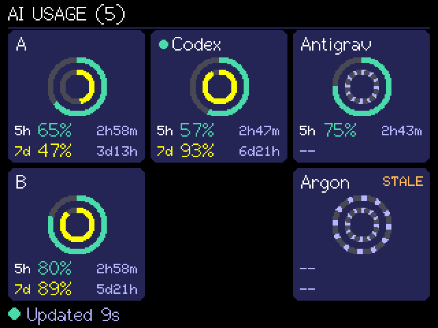
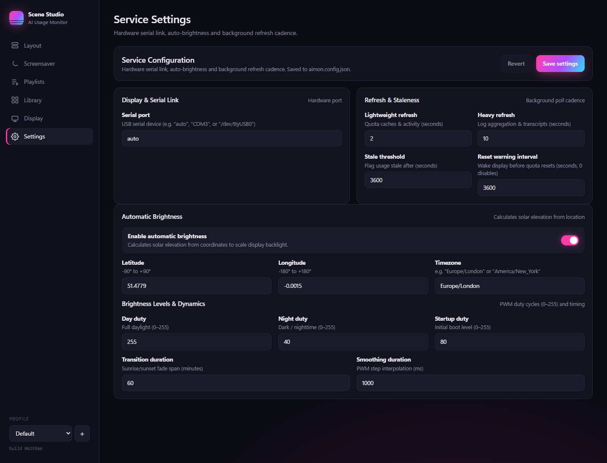
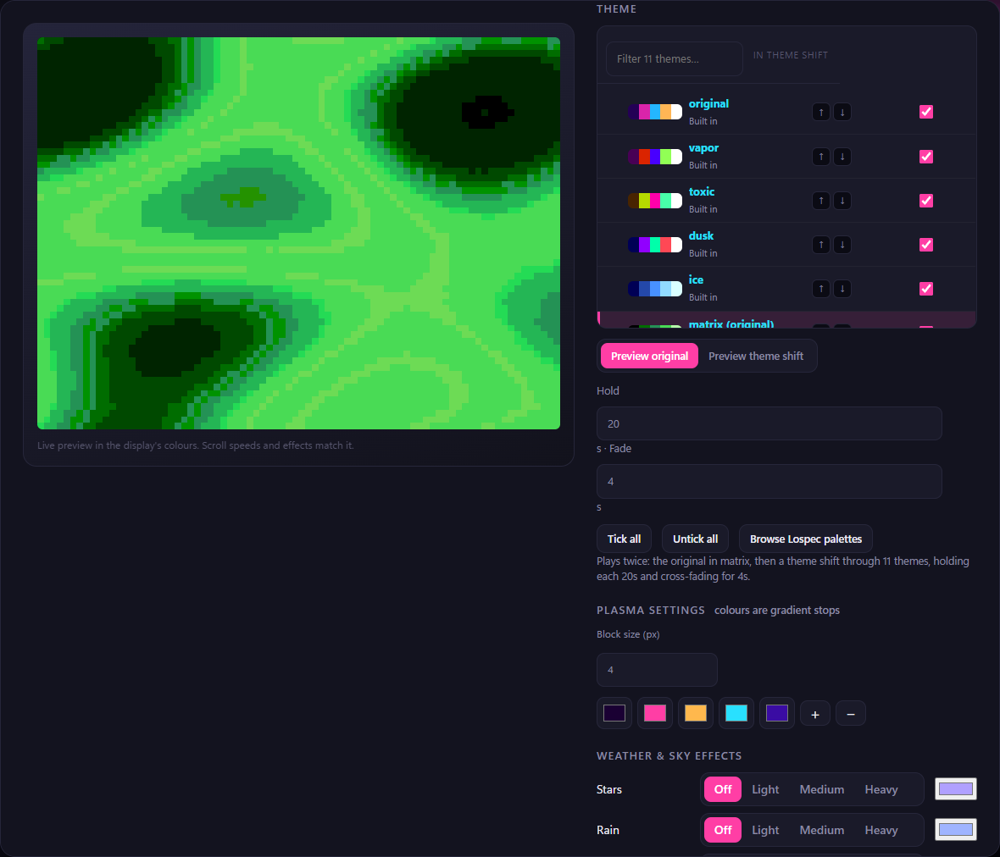
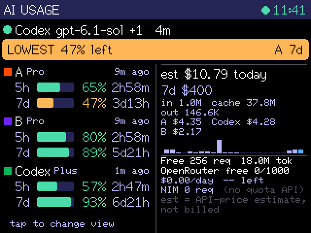
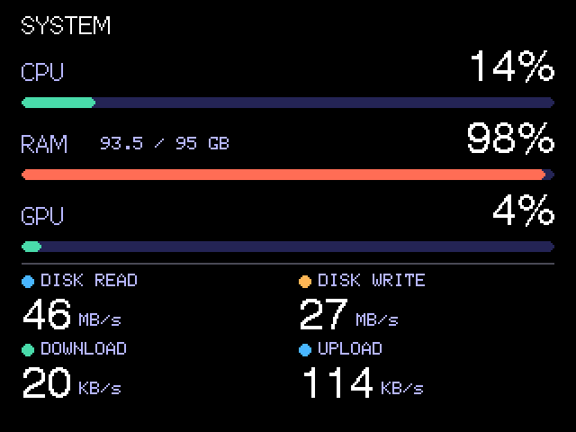

# AI Usage Monitor

A small, always-visible AI usage dashboard for your desk. An ESP32 touchscreen shows subscription quota remaining and reset countdowns, while a Python service collects usage telemetry from local developer tools.



*Actual display framebuffer captured over USB. The console renders at 320×240; the image is enlarged 2× for readability. This is a screen capture, not a hardware photograph. Unknown Argon quota remains visibly unknown.*

Built to sit beneath a monitor and answer a quick question: how much allowance is left, and when does it reset?

## What it does

- Selectable Console layout: the original Claude A / Claude B / Codex rows, or a compact six-account grid (Default) with concentric Session and Weekly rings.
- Exact percent remaining, bright reset countdowns and a yellow weekly ring for quick recognition.
- A whole-screen tap switches between the clean console and a detailed activity, token and cost dashboard.
- Cached measurements remain visible when data is stale or disconnected; unknown is distinct from zero.
- USB serial carries compact JSON from the PC. The display holds no account credentials.
- The collector combines T3 status caches, Claude/Codex transcripts and OpenCode history. Optional OpenRouter key-status polling adds reported allowance and spend data.
- A System page, styled like Task Manager, shows the PC's CPU, RAM and GPU load, disk read/write, and download/upload rates. Updates arrive about once a second (GPU on Windows only; needs `psutil`).
- Optional automatic backlight: the service dims the display at night and brightens it during daylight using local sunrise/sunset times (set your location in `service/aimon.config.json`; the default is a placeholder). See [automatic brightness](docs/BRIGHTNESS.md).

This is a working, board-specific project, tested on Windows with an ESP32-2432S024C. It is not a universal usage API: subscription readings depend on the data your local tools have already recorded.

## How it works

```text
T3 caches + local transcripts + OpenCode history
                     |
              Python collector
                     |
         compact JSON over USB serial
                     |
       ESP32 -> TFT framebuffer -> display
```

The service also exposes a localhost HTTP API for diagnostics and optional Wi-Fi polling. Lightweight quota/activity reads run every 2 seconds, transcript processing every 10 seconds, and USB heartbeats every 5 seconds; changed measurements also request an immediate push. Available quota keeps the dashboard awake for the hour before a reported reset. The app does **not** force a provider request or assume a refill. See [data sources and freshness](docs/DATA_SOURCES.md).

## Scene Studio and live display views

Scene Studio edits profiles, playlists and procedural scenes, previews them, and sends builds to the display. Its Settings tab configures the local service without editing JSON; saved service settings take effect after restarting the service. [Studio guide](docs/STUDIO.md).





| Details | System | Companion |
| --- | --- | --- |
|  |  |  |

Display captures show real running views; Studio Settings uses an isolated configuration with public defaults. No personal art or credentials are included. See [release evidence](docs/RELEASE_1.14.0.md).

## Hardware

- **ESP32-2432S024C**, integrated 2.4-inch ILI9341 240×320 display and CST820 capacitive touch.
- A USB **data** cable and a PC; no external jumper wiring is required for this integrated board.
- Optional desk mount or enclosure; none is included in this repository.

The display is used in landscape at 320×240. The implemented TFT connections are MISO 12, MOSI 13, SCLK 14, CS 15, DC 2 and backlight 27. Touch uses SDA 33, SCL 32 and reset 25. See the [complete pinout and board-variant notes](docs/HARDWARE.md) before adapting it to another board.

## Get started

The tested baseline is Python 3.13, pyserial 3.5, Arduino CLI 1.2.0, ESP32 Arduino core 3.3.1, TFT_eSPI 2.5.43 and ArduinoJson 7.4.2. The helper scripts use Windows PowerShell.

After installing the toolchain and libraries in the [setup guide](docs/SETUP.md), run from the repository root:

```powershell
python -m pip install -r service/requirements.txt
Copy-Item service/aimon.config.example.json service/aimon.config.json
.\scripts\build.ps1
.\scripts\flash.ps1
.\scripts\service.ps1 start
.\scripts\service.ps1 status
```

The example config keeps HTTP on localhost and disables optional OpenRouter access. Without it, code defaults enable that source. Local settings and Wi-Fi credentials are Git-ignored.

For the original three console rows, use T3 display names `A`/`B`/`Codex`, `CL1`/`CL2`, or the supported Claude A / Claude B prefixes. Select Grid in Studio's Console layout setting for up to six accounts. The named landscape setup pins A/B left, Codex top centre, and Antigrav/Argon right, leaving bottom centre empty. Gemini uses a direct quota probe through the existing T3 login; its weekly quota and the independent Argon quota stay unknown when unavailable. See [data sources](docs/DATA_SOURCES.md) and [UI configuration](docs/UI.md).

## Reading the display

Rings show **remaining** quota: full means all allowance remains. Session colors follow capacity thresholds; Weekly stays yellow. `--` means unavailable, `due` means a reset deadline passed, and `STALE` (or an amber footer dot) means the source or link has aged; a red footer dot is a source error. A fresh USB connection does not guarantee a fresh provider measurement.

Tap to open the detailed dashboard for activity, quota windows, reset credits, token totals, free-model activity and API-equivalent cost estimates. Those estimates are **not subscription charges**. Cached values are held in RAM and are lost on device reboot.

## Development and verification

Service tests use fixtures and make no network requests:

```powershell
Push-Location service
python -m unittest discover -s tests -t .
Pop-Location
```

Capture the connected display after starting the service:

```powershell
python scripts/screenshot.py --feed --out build/dashboard.png
```

The release verification includes 49 passing service tests, 20 Studio tests and browser checks of settings persistence and scene controls. Firmware builds and USB framebuffer captures verify the documented board and rendered layout. Physical comfort, logon execution and optional Wi-Fi have separate limits documented in the [test report](docs/TEST_REPORT.md).

## Documentation

| Guide | Contents |
| --- | --- |
| [Setup](docs/SETUP.md) | Fresh-machine installation, configuration, running and troubleshooting |
| [Hardware](docs/HARDWARE.md) | Board identity, GPIO pinout, buses, touch and orientation |
| [Brightness](docs/BRIGHTNESS.md) | Location-based automatic backlight, configuration and troubleshooting |
| [Data sources](docs/DATA_SOURCES.md) | What is collected, refresh timing and integration limitations |
| [Protocol and API](docs/PROTOCOL.md) | Serial framing, payloads, commands and localhost routes |
| [UI](docs/UI.md) | Renderer layout, configuration and extension points |
| [MINT companion](docs/MINT.md) | Grobot face, emotions, PC behavior, local reactions and verification limits |
| [Image and animation research](docs/IMAGE_ANIMATION_RESEARCH.md) | Candidate authoring, conversion and playback workflow for future visual assets |
| [Visual pages implementation plan](.tickets/T-008.md) | Navigation and MINT implemented; automatic idle/wake behavior is documented in [Screensaver](docs/SCREENSAVER.md). Scenes/assets and broader measurements remain follow-up work |
| [Tests](docs/TEST_REPORT.md) | Verified behavior, evidence and untested assumptions |
| [Contributing](CONTRIBUTING.md) | Development and validation expectations |
| [Project log](docs/PROJECT_LOG.md) | Implementation decisions and milestones |
| [Release preparation](docs/PUBLIC_RELEASE.md) | Owner review and remaining publication decisions |

## Privacy and limitations

The firmware receives display metadata and aggregate measurements, not prompts, transcript text or credentials. The collector reads local histories and databases without modifying them. Optional OpenRouter access uses an existing API key from the environment or OpenCode's auth file; [the data-source guide](docs/DATA_SOURCES.md) explains that exception.

The HTTP API is unauthenticated and intended for localhost. Optional LAN/Wi-Fi operation needs deliberate network configuration and has not been tested on hardware. Local application cache/database schemas may change. Similar-looking ESP32 display boards can use different controllers or pins.

## License

[MIT](LICENSE). Third-party dependencies retain their own licenses. This is an independent project, not affiliated with or endorsed by the AI providers or tools it reads.

Powered by [SunriseSunset.io](https://sunrisesunset.io) for automatic backlight sun times.
