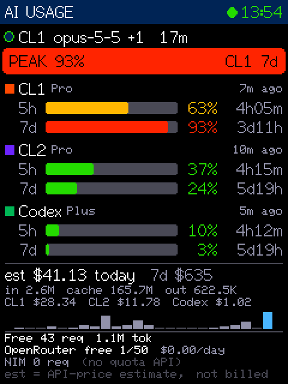
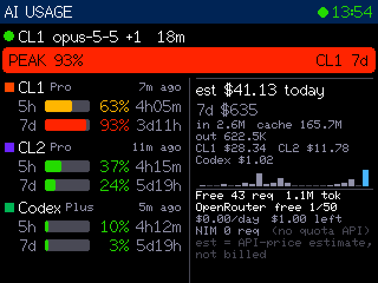

# AI Usage Monitor

A small dashboard on the ESP32-2432S024C (2.4" ILI9341) showing AI quota, activity, and usage. The data comes from what T3 Code, Claude Code, Codex, OpenCode, and OpenRouter already record on this PC.

```
 PC (localhost only)                                    ESP32-2432S024C
 ┌───────────────────────────────────────────┐  USB    ┌──────────────────┐
 │ aimon service (Python, stdlib + pyserial)  │ serial  │ firmware         │
 │  ~/.t3/caches  → quota windows             ├────────►│ JSON line / 5 s  │
 │  statev2.sqlite → running / idle           │ CH340   │ → dashboard      │
 │  Claude + Codex transcripts → tokens, est. │ COM6    │ no credentials   │
 │  opencode.db → free-model activity         │         └──────────────────┘
 │  OpenRouter /key → free req/day, spend     │
 │  HTTP 127.0.0.1:8797 (/v1/device, /healthz)│
 └───────────────────────────────────────────┘
```

| Doc | Purpose |
| --- | --- |
| [docs/HARDWARE.md](docs/HARDWARE.md) | Verified board, chip, pinout, orientation, uncertainties |
| [docs/DATA_SOURCES.md](docs/DATA_SOURCES.md) | Each usage source, its metrics, and what's unavailable |
| [docs/TEST_REPORT.md](docs/TEST_REPORT.md) | What was verified on the device vs. assumed |
| [docs/PROJECT_LOG.md](docs/PROJECT_LOG.md) | Decisions and why |
| [HANDOFF.md](HANDOFF.md) | Current state, open items, next actions |

 

## Reading the screen

Version 1.3 has exactly two views. **Tap anywhere** to toggle between the three-client status console and the original detailed dashboard. The console emphasizes each client's most urgent quota and its reset countdown, with the other quota kept separate. Bars ease toward new readings; percentages show the exact measurement. See [the UI guide](docs/UI.md) for customization and future Claude work.

Last measured quota values remain bright and visible during stale connections, missing readings, and passed reset deadlines. `CACHED` / the header status indicates freshness. After a reset deadline, `awaiting update` means a fresh provider reading is needed; the display does not assume a refill. Cache lives in RAM and resets on reboot.

- **Header:** the green dot plus a time means the last payload is fresh. `!` (amber) means a source failed (named in the detailed footer). `NO DATA 2m` (red) means nothing has arrived for 30 s; the last values stay fully visible.
- **Activity:** a pulsing green dot means a T3 turn is running: account, model, elapsed time, and `+N` other running threads. Otherwise it shows `idle` with the last account and model.
- **LOWEST … left** (or **PEAK … used**): the most-depleted *fresh* quota window, naming the account and window it comes from. Windows are not averaged together.
- **Accounts:** one block per subscription (CL1, CL2, Codex). Each shows its 5 h session and 7 d weekly windows: bar, percent **left** (default; see below), time to reset, and how old T3's reading is. Colours always track usage: red means nearly exhausted.
  - `Pro (1x reset)` in blue means the provider reports banked limit resets you can redeem in T3 (Usage → Limits → account → **Use reset**). With none, it shows just the plan.
  - `STALE` means older than 20 min.
  - `--` with a hatched bar means no measurement has been received. It is never shown as 0.
- **est $ today / 7d:** the **API-price estimate** of tokens used by the subscription accounts, per account, with a 24 h hourly sparkline. It is *not* money billed to a subscription. `+unpriced` means some models had no known price.
- **Free / OpenRouter / NIM:**
  - Free-model calls and tokens today (OpenCode history).
  - OpenRouter's free-model daily allowance, actual spend today, and budget left.
  - NVIDIA NIM requests. NIM exposes no quota API.

## Display orientation

Set `DISPLAY_ROTATION` in [`firmware/AIUsageMonitor/config.h`](firmware/AIUsageMonitor/config.h), then build and flash. "Traditional" means the landscape orientation all your earlier sketches used (`setRotation(1)`).

| Value | Mounting | Screen |
| --- | --- | --- |
| `2` | Portrait, traditional **right** edge facing up | 240×320, one column |
| `0` (default) | Portrait, traditional **left** edge facing up | 240×320, one column |
| `1` | Landscape, traditional | 320×240, two columns |
| `3` | Landscape, upside down | 320×240, two columns |

You can preview a rotation without reflashing; it reverts on reboot:

```powershell
python scripts\screenshot.py --rot 1 --out build\preview.png
```

The PNG shows the frame buffer exactly as sent to the panel.

## Remaining vs. used

`SHOW_REMAINING` in `config.h` (default `1`) shows quota **left**: a full bar is a full allowance. Set it to `0` to show quota **used**; the banner then becomes `PEAK n% used`. Rebuild and flash after changing it.

## Build, flash, run

Prerequisites already on this PC: Arduino IDE 2 (bundled `arduino-cli`), `esp32:esp32` 3.3.1, TFT_eSPI, ArduinoJson, Python 3.13 with pyserial.

```powershell
.\scripts\build.ps1              # compile (add -Rotation N to override config.h)
.\scripts\flash.ps1              # upload to the CH340 port; pauses/resumes the service itself
.\scripts\service.ps1 start      # run the service in the background (pythonw, no window)
.\scripts\service.ps1 status     # health: serial port, last push/ack, device firmware
.\scripts\service.ps1 restart
.\scripts\service.ps1 stop
.\scripts\service.ps1 install    # start at logon (per-user task "AI Usage Monitor (aimon)") - installed
.\scripts\service.ps1 uninstall
```

Opening the Arduino IDE serial monitor, or any other program on COM6, competes with the service for the port. Stop the service first, or use `flash.ps1`, which coordinates.

Building from the Arduino IDE also works, because your sketchbook's `TFT_eSPI/User_Setup.h` has the same pins. Select **ESP32 Dev Module**, 4 MB flash.

### Service

- Logs are in `logs/aimon.log`, one `key=value` line per event, e.g. `evt=source.failed src=openrouter err=offline`.
- One-shot payload dump: `cd service; python -m aimon --once`.
- Tests: `cd service; python -m unittest discover -s tests -t .` (22 tests, fixtures only, no network).
- Settings (`service/aimon/config.py`) can be overridden in `service/aimon.config.json` (git-ignored) or with `AIMON_<NAME>` env vars:
  - port: `bind_port` (default 8797)
  - serial: `serial_port` (default `auto`)
  - refresh: `refresh_s` (default 10)
  - OpenRouter polling: `openrouter_refresh_s` (default 600)
  - staleness: `limits_stale_s` (default 1200)

### Optional Wi-Fi mode (not enabled, untested)

USB is used because the PC is on wired Ethernet with a *Public* firewall profile, and the device is always plugged in.

To use Wi-Fi anyway:

1. Copy `firmware/AIUsageMonitor/secrets.example.h` to `secrets.h`. It is git-ignored. Use a 2.4 GHz SSID.
2. Set `AIMON_USE_WIFI 1` in `config.h`.
3. Set `bind_host` to the PC's LAN IP in `aimon.config.json`.
4. Allow inbound TCP 8797 from the local subnet only.

The service has no credentials to expose, but the HTTP API's pause/resume endpoints would then be reachable on the LAN.

## Privacy and safety

- The firmware receives only display names (CL1, CL2, Codex), percentages, counts, and estimates. E-mails, tokens, and keys never leave the PC.
- The service opens T3/OpenCode databases read-only and never refreshes logins.
- The only outbound call is OpenRouter's `/api/v1/key` status endpoint, every 10 min, using the key already in your environment. It sends no prompt and uses no quota.
