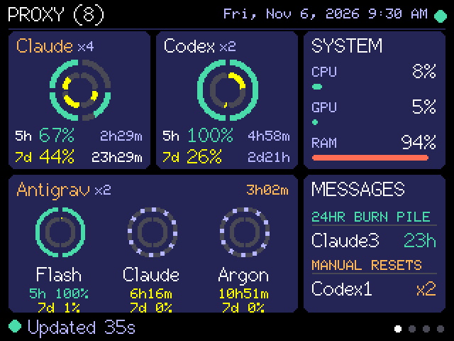
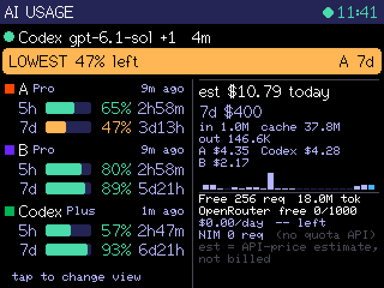
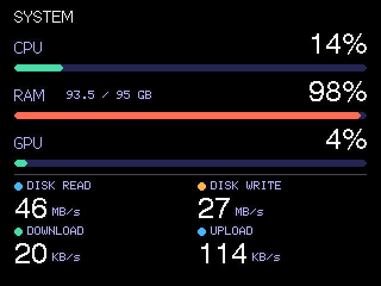
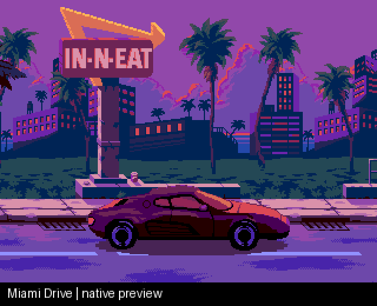

# AI Usage Monitor

**A little screen on your desk that tells you how much AI you have left, and when it refills.**

If you pay for Claude, Codex, Gemini or a few of them at once, you know the feeling: you're mid-task and wonder whether you have enough allowance left, or whether you should have started that big job an hour ago. This project puts the answer in the corner of your eye. It's a small ESP32 touchscreen that sits under your monitor and shows quota rings, reset countdowns and a few other useful things, all day, without you opening a single dashboard.



*A real capture from the running display (320×240, shown at 2×). Not a mock-up.*

It's free, MIT-licensed and a hobby project. It works well for me and I'd love for it to work for you too, and to see what you do with it.

## What you get

- **Quota at a glance.** Concentric rings for the session (5h) and weekly windows, the exact percent left, and a countdown to the next reset. Full ring means plenty left.
- **A "use it or lose it" list.** The Messages card shows accounts that still have quota in a window that resets within 24 hours, soonest first, plus any banked manual resets you can spend.
- **Many accounts, one view.** If you pool accounts through a [CLIProxyAPI](https://github.com/router-for-me/CLIProxyAPI) proxy, each account gets its own slice of the ring. The classic Console view also works without a proxy.
- **Honest numbers.** Unknown shows as unknown, never as zero. Stale data stays on screen and is marked as stale. A passed reset time is not treated as a refill.
- **More than quotas.** Tap through a details page (activity, tokens, API-equivalent cost estimates), a Task-Manager-style system page (CPU, RAM, GPU, disk, network), and a small animated companion.
- **A screensaver that's actually fun.** Pixel-art scenes and procedural effects, plus an optional automatic backlight that dims at night using your local sunrise and sunset.
- **Private by design.** The screen never sees your prompts, transcripts or credentials. It only gets compact numbers over USB.

| Details | System | Companion |
| --- | --- | --- |
|  |  |  |

## What you need

- An **ESP32-2432S024C**: an ESP32 with a built-in 2.4" touchscreen. No wiring, just a USB **data** cable (some cables only charge).
- A PC. It's built and tested on **Windows** (the helper scripts are PowerShell). Linux and macOS are not tested.
- At least one source of usage data. The service reads what your local tools already record: [T3](docs/DATA_SOURCES.md) caches, Claude and Codex transcripts, OpenCode history, and optionally your OpenRouter key.

This is a board-specific project, not a universal usage API. Look-alike boards can use different controllers or pins, so check the [hardware notes](docs/HARDWARE.md) before buying or adapting anything.

## Get it running

You can do it by hand with the [setup guide](docs/SETUP.md), or let your AI coding agent do it.

### Option 1: by hand

The tested baseline is Python 3.13, Arduino CLI 1.2.0 and the ESP32 core 3.3.1. Install those and the libraries listed in the [setup guide](docs/SETUP.md), then from the repo root:

```powershell
python -m pip install -r service/requirements.txt
Copy-Item service/aimon.config.example.json service/aimon.config.json
.\scripts\build.ps1
.\scripts\flash.ps1
.\scripts\service.ps1 start
.\scripts\service.ps1 status
```

Local settings stay in `service/aimon.config.json`, which Git ignores.

### Option 2: let your AI do it

Clone the repo, open it in your agent (Claude Code, Codex, Gemini CLI, OpenCode, anything that can run shell commands), and paste this. It asks everything up front, then does the rest without more questions.

````text
You are setting up AI Usage Monitor from this repository for me. Read README.md,
docs/SETUP.md, docs/HARDWARE.md and docs/DATA_SOURCES.md first.

STEP 0 - Protect my updates. Read AGENTS.md and docs/recipes/customise-safely.md.
Keep `main` untouched and do all my changes on a `my-setup` branch with my own
profile (profiles/my.json), so I can take new releases from upstream later. Log any
tracked file you edit in docs/MY_CHANGES.md. Run scripts/doctor.ps1 when done.

STEP 1 - Check, then ask. Before changing anything, verify what you can yourself
(OS, Python version, whether arduino-cli is installed, whether a CH340 serial port
is present). If the OS is not Windows or my board is not an ESP32-2432S024C, stop
and tell me what is untested. Otherwise ask me ALL of these in one message, and
suggest a default for each:
  1. Which AI tools do I use? (T3, Claude Code, Codex, OpenCode, OpenRouter,
     CLIProxyAPI proxy, Antigravity/Gemini)
  2. Home screen: Proxy view (needs CLIProxyAPI) or the classic Console?
  3. Automatic night dimming? If yes, my city or lat/long and timezone.
  4. Screen orientation and screensaver preferences (scenes, how long until it starts).
  5. Do I want the System page (CPU/RAM/GPU) and the companion face?
  6. Should the service start automatically when I log in?

STEP 2 - Build it. After I answer, do everything without asking again: install
missing tools and Python packages, create service/aimon.config.json from the
example using my answers, build and flash the firmware, start the service, and
install the logon task only if I said yes.

STEP 3 - Prove it works. Run scripts/service.ps1 status, then capture the display
with scripts/screenshot.py and show me the image. If something fails, diagnose the
root cause, fix it, and retry. Never print or commit API keys or tokens; refer
to them by name. Do not run the test suite unless I ask.

Finish with a short summary: what you installed, where the config lives, and the
three commands I need to restart, check and stop the service.
````

### Open it up and make it yours

Scene Studio is a small local app for editing profiles, playlists and screensaver scenes, previewing them, and sending them to the display. Double-click `Scene Studio.cmd`, or read the [Studio guide](docs/STUDIO.md).



*Preview from the firmware's own renderer, not hardware footage.*

### Keep getting updates

Your changes live on your own `my-setup` branch, and your config, keys and art stay out of Git, so new releases merge in without touching them. Scene Studio has an **Updates** tab that checks for releases, previews conflicts, updates with a backup and can undo it. If you'd rather have your agent do it, paste this:

````text
Update AI Usage Monitor to the latest release by following
docs/recipes/update.md exactly. Tag a backup first, keep my customisations, rebuild
and flash, then show me a framebuffer capture. Ask me before discarding anything.
````

Agents working on this repo read [AGENTS.md](AGENTS.md) first. It points to step-by-step [recipes](docs/recipes/README.md) for adding a card, a scene or a data source, and for fitting another screen size, written so even a small model can follow them.

Want to go further? Ask your agent. A few starters:

````text
Read docs/UI.md and docs/ASSETS.md. Add a new screensaver scene in the style of
<describe it>, add it to my profile's playlist, preview it in Studio, and show me a
framebuffer capture. Ask me first if you need art I haven't given you.
````

````text
Read docs/PROTOCOL.md and docs/DATA_SOURCES.md. Add a new data source for <tool or
API> to the service so its quota shows as a tile on the display. Keep unknown
distinct from zero, never print credentials, and show me a capture when it works.
````

````text
Read docs/UI.md. Change the Messages card so that <what you want>. Rebuild, flash,
and show me a framebuffer capture before and after.
````

## How it works

```text
T3 caches + local transcripts + OpenCode history + optional proxy
                              |
                       Python service (PC)
                              |
                compact JSON over USB serial
                              |
                 ESP32 draws it on the screen
```

The service reads your local data read-only and pushes small updates to the screen every few seconds. It never forces a request to a provider and never guesses a refill. The ESP32 holds no credentials and only draws what it's sent. Details are in [data sources and freshness](docs/DATA_SOURCES.md) and the [protocol](docs/PROTOCOL.md).

### Reading the display

- Rings show what's **left**. Full means plenty.
- `--` means unknown. `due` means a reset time has passed. `STALE`, or an amber footer dot, means the data has aged. A red footer dot is a source error.
- Cost figures are API-equivalent estimates, **not** what your subscription charges you.

## Privacy and limits

The screen gets display numbers, not prompts, transcripts or credentials. The service reads local histories and databases without modifying them. Optional OpenRouter polling uses an API key you already have; the [data-source guide](docs/DATA_SOURCES.md) explains that one exception.

The service's HTTP API has no authentication and is meant for localhost only. Wi-Fi use is untested on real hardware. The local caches this reads can change format when those tools update, so a tool update can break a reading until the service catches up. A reset countdown is only as fresh as the data behind it, and the manual-reset expiry date comes from Codex's reset-credits endpoint, so it only appears for accounts that report it.

## Docs

| Guide | What's inside |
| --- | --- |
| [Setup](docs/SETUP.md) | Fresh-machine install, configuration, running, troubleshooting |
| [Hardware](docs/HARDWARE.md) | Board identity, pinout, touch, orientation |
| [Studio](docs/STUDIO.md) | Profiles, playlists, scenes, live display |
| [UI](docs/UI.md) | Layouts, configuration, extension points |
| [Data sources](docs/DATA_SOURCES.md) | What is collected, how often, and its limits |
| [Protocol and API](docs/PROTOCOL.md) | Serial framing, payloads, localhost routes |
| [Brightness](docs/BRIGHTNESS.md) | Automatic backlight by sunrise and sunset |
| [Companion](docs/MINT.md) | The animated face and its behavior |
| [Assets](docs/ASSETS.md) | Image, GIF and scene pipeline |
| [Agent guide](AGENTS.md) and [recipes](docs/recipes/README.md) | Rules and step-by-step procedures for AI agents, including safe updates |
| [Tests](docs/TEST_REPORT.md) | What was verified and what wasn't |
| [Releases](https://github.com/zdhoward/AIUsageMonitor/releases) | Release notes, newest first |

## Contributing

Bug reports, board variants and new data sources are all welcome. Read [CONTRIBUTING.md](CONTRIBUTING.md) first. If you report a hardware issue, include your board and controller. To run the service tests (fixtures only, no network):

```powershell
Push-Location service
python -m unittest discover -s tests -t .
Pop-Location
```

## License and credits

[MIT](LICENSE), Copyright (c) 2026 Zach Howard. Third-party libraries and asset packs keep their own licenses: see [THIRD_PARTY_NOTICES.md](THIRD_PARTY_NOTICES.md) and [docs/THIRD_PARTY.md](docs/THIRD_PARTY.md). The optional city scenes use layers by Luis Zuno / Ansimuz (CC0); [get the optional scene pack](https://github.com/zdhoward/AIUsageMonitor/releases/tag/v1.14.1).

This is an independent project, not affiliated with or endorsed by the AI providers or tools it reads. Sunrise and sunset times for automatic brightness are powered by [SunriseSunset.io](https://sunrisesunset.io).
