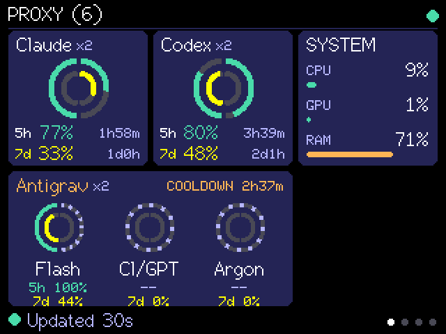

# v1.15.0 — Proxy Home and individual account quota rings

Proxy Home reads live subscription quotas through the CLIProxyAPI Console management proxy. Provider tiles show aggregate remaining quota and the earliest upcoming reset, alongside a System card and multi-pool Antigravity tile. Provider profiles describe usage requests and response mappings.

Each account now occupies an equal sector of the session and weekly rings: halves for two accounts, thirds for three. Ten-degree gaps make the endpoints clear. Anonymous account ordering is stable, unknown quota remains dashed, and a passed reset deadline no longer invents a refill. Successful current quota probes supersede stale account error metadata; current authentication failures still warn.

## Verification

- Production firmware build and hash-verified upload succeeded; real USB framebuffers were inspected. The owner accepted the final spacing.
- Live probes confirmed both enabled Codex accounts return short and weekly readings. Aggregate numbers and earliest upcoming reset captions remain intact.
- Automated tests are deferred to the owner's testing phase. Prior release test counts do not describe this release.
- Source review covered the Python pooling/probe path and firmware parsing/rendering. No independent review pass is claimed for the final warning and gap adjustments.

## Limits and installation

Per-account sectors support up to eight accounts per provider. Larger groups or serial payload pressure fall back to aggregate rings. Individual reset epochs are retained in the protocol, while visible reset captions remain group summaries. Account identities and credentials are not sent to the display.

Restart the Python service and build/flash the firmware together using the [setup instructions](SETUP.md). Aggregate-only older payloads remain supported. The optional CC0 scene pack remains available from v1.14.1.

This is a source release. Compiled firmware is not distributed while the existing third-party binary-distribution obligations remain unresolved; see [third-party notices](../THIRD_PARTY_NOTICES.md). Portrait, high account counts, fallback and broader failure-state acceptance remain pending. Weather work and T-033 layout polish remain backlog.
