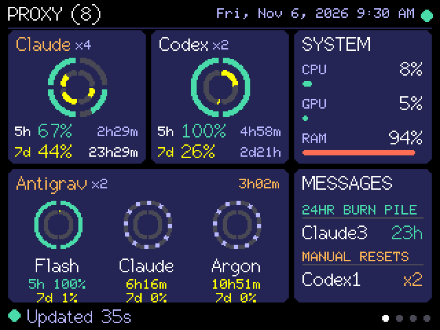

# v1.16.0 — Header clock and a clearer Messages card

Firmware and service both change; reflash the display and restart the service.

- The Proxy header shows the local date and time (`Fri, Nov 6, 2026 9:30 AM`) beside the status dot. The service now sends `tz`, its local UTC offset, with each proxy line, so daylight saving is followed. The clock hides until the first proxy line arrives.
- The Messages card is easier to read from a distance: larger rows, colour-coded headings, and leftover height spread evenly. The small percent-left figure appears only when the account name still fits.
- Manual-reset expiry dates are not shown. The Codex usage API and T3's cache report only a count of banked resets, so the card shows the count.

## Verification

- Production build (45% flash), hash-verified USB upload to COM6, service restarted, framebuffer capture inspected (`docs/img/display-proxy.png`).
- Automated tests were not run (deferred to the owner's testing phase). No test covers the new `tz` field yet.
